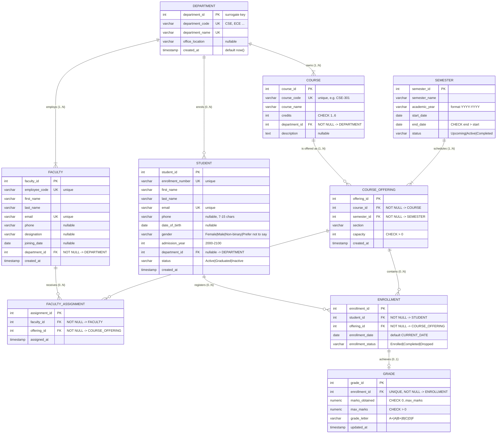

# Entity Relationship Diagram — CampusOS

The full diagram is available in three forms:

| File | Purpose |
| --- | --- |
| `docs/ER_Diagram.png` | Rendered diagram (4898 × 6000 px, dark theme) — use this in the report/viva |
| `docs/ER_Diagram.mmd` | Mermaid source that produced the PNG |
| `docs/ER_Diagram.md` | This file: diagram plus the participation constraints in words |

Regenerate the PNG after editing the source:

```bash
npm install -g @mermaid-js/mermaid-cli
mmdc -i docs/ER_Diagram.mmd -o docs/ER_Diagram.png -t dark --size 3000 -b "#0B0F19"
```

## Legend

- `PK` primary key, `UK` unique (candidate) key, `FK` foreign key
- `||--o{` one-to-zero-or-many, `||--|{` one-to-one-or-many, `||--o|` one-to-zero-or-one
- Crow's foot on the right-hand side is the "many" end
- Participation is written as `(min..max)` on each relationship label
- `NOT NULL` in an attribute description means the relationship is mandatory in SQL



## Participation constraints at a glance

| Relationship | Parent participation | Child participation | Enforced by |
| --- | --- | --- | --- |
| Department → Student | Optional: a department may have zero students | Optional: `student.department_id` is nullable | Query in `schema.sql`; nullable FK |
| Department → Faculty | Optional: a new department may have no staff yet | **Mandatory**: every faculty belongs to exactly one department | `faculty.department_id NOT NULL` |
| Department → Course | Optional: a department may own zero courses | **Mandatory**: every course belongs to one department | `course.department_id NOT NULL` |
| Course → CourseOffering | Optional: a course may never be offered | **Mandatory**: each offering references one course | `course_offering.course_id NOT NULL` |
| Semester → CourseOffering | Optional: a semester may have no offerings | **Mandatory**: each offering belongs to one semester | `course_offering.semester_id NOT NULL` |
| Faculty ↔ CourseOffering | Optional on both sides (a faculty member may teach nothing; an offering may have no teacher assigned yet) | Each assignment row is mandatory for both sides | `faculty_assignment` with `NOT NULL` FKs + unique pair |
| Student ↔ CourseOffering | Optional on both sides | Each enrollment row is mandatory for both sides | `enrollment` with `NOT NULL` FKs + unique pair |
| Enrollment → Grade | Optional: an enrollment may exist without a grade | **Mandatory**: every grade references exactly one enrollment | `grade.enrollment_id NOT NULL UNIQUE` |

Every many-to-many relationship is resolved by an association table
(`faculty_assignment`, `enrollment`), so no repeating groups or array columns exist
anywhere in the schema.
