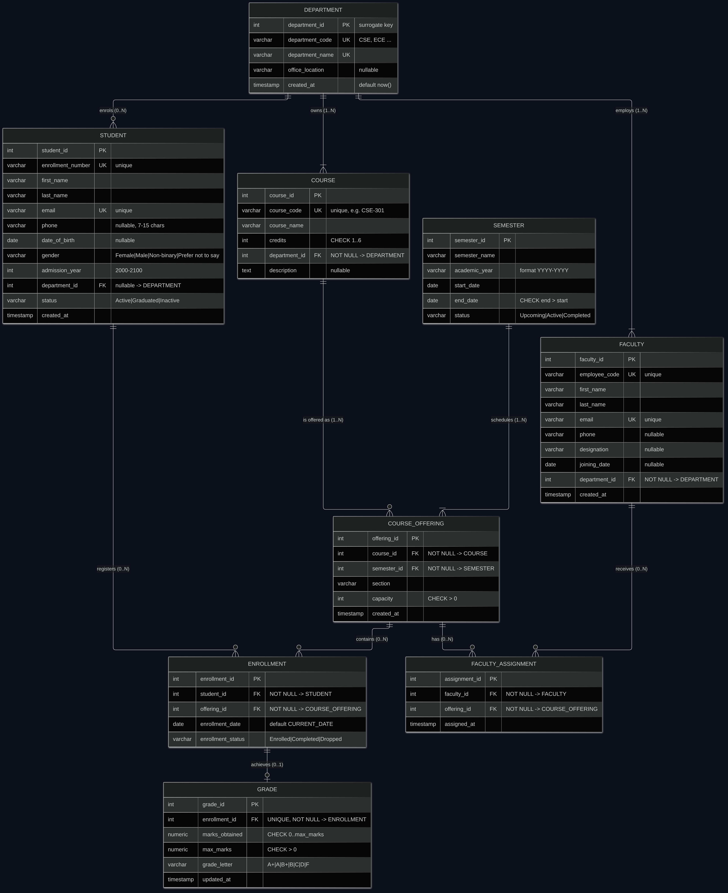

# Project Report — CampusOS: College Management System

**Course:** Database Management Systems
**Project type:** Full-stack database application
**Stack:** PostgreSQL 16 · FastAPI (Python) · React 18 + Vite + Tailwind CSS
**Repository layout:** `backend/`, `frontend/`, `database/`, `docs/`, `scripts/`

---

## Abstract

Manual college administration — registers, mark sheets and attendance sheets — leads to
duplicated data, inconsistent records and slow reporting. CampusOS replaces those
registers with a normalised relational database and a web administration dashboard.
Nine relations model departments, students, faculty, courses, semesters, course
offerings, faculty assignments, enrollments and grades. Every rule that protects the
data (unique admission numbers, valid credits, valid statuses, non-negative marks, no
over-capacity classes, no orphan records) is enforced by PostgreSQL constraints and
triggers, not merely by the web form. The schema is in Third Normal Form (in fact
BCNF), and facts such as student names or course titles are stored exactly once and
recombined with SQL joins. A REST API built with FastAPI exposes complete CRUD plus
dashboard and report endpoints, and a React dashboard presents live statistics, charts
and management screens.

## 1. Introduction

A college office keeps the same information in many places: a student's name appears in
the admission register, the attendance sheet and the mark sheet; a course's credits
appear in every row of every result table. When a department changes its name or a
course changes its credits, every copy must be edited, and any missed copy becomes a
contradiction. Relational database design solves this by storing each fact once and
linking records by keys.

This project implements that design end to end: a normalised PostgreSQL schema, a
Python API that performs CRUD with transaction safety, and a modern React interface
that a college administrator can actually use.

## 2. Problem statement

1. Student, faculty, course and result data are kept in separate spreadsheets that
   cannot be cross-checked.
2. The same fact (student name, course credits, department name) is repeated, so
   updating one copy leaves the others stale.
3. There is no protection against impossible data: a course with 0 credits, a class
   with 200 students in a 60-seat room, a mark of 90 out of 80.
4. Deleting a department silently destroys the academic history of everyone in it.
5. Producing a simple report ("students per department", "grades per course") requires
   manual work.

## 3. Objectives

1. Design an ER model for the academic domain with clear cardinalities and
   participation constraints.
2. Translate it into nine relations in 3NF with primary, foreign, unique, check and
   not-null constraints.
3. Enforce business rules — including class capacity — inside the database.
4. Provide complete CRUD for every entity through a documented REST API.
5. Build a responsive administrative dashboard whose statistics and charts are live
   SQL results.
6. Provide report endpoints with CSV export.
7. Prove correctness with automated tests (API + database constraints + concurrency)
   and a database verification script.

## 4. Scope

**Included:** department, student, faculty, course, semester, course offering, faculty
assignment, enrollment and grade management; dashboard analytics; reports with CSV;
validation and readable error messages; automated tests.

**Excluded (documented, not faked):** user authentication and role-based access (the
UI is clearly labelled a local administrative demo), fee management, attendance,
hostel/library modules, email notifications, and cloud deployment.

## 5. Technology stack

| Layer | Technology | Why |
| --- | --- | --- |
| Database | PostgreSQL 16 | Real relational engine: constraints, triggers, transactions, `FOR UPDATE` row locks |
| ORM / driver | SQLAlchemy 2.0 + psycopg 3 | Typed models, safe parameter binding |
| API | FastAPI + Pydantic v2 | Automatic validation, OpenAPI docs, structured errors |
| Server | Uvicorn | Development ASGI server |
| Frontend | React 18 + Vite | Fast SPA development |
| Styling | Tailwind CSS | Consistent design tokens, responsive layout |
| Routing | React Router | Sidebar navigation and detail pages |
| Forms | React Hook Form | Client-side validation with server error mapping |
| Charts | Recharts | Bar, line, donut charts from live data |
| HTTP | Axios | Central error handling |
| Icons | Lucide React | Minimal icon set |
| Tests | pytest + httpx TestClient, Chromium UI smoke script | API, DB constraints, concurrency and UI verification |

## 6. Database design

### 6.1 Entities and keys

| Table | Primary key | Alternate keys |
| --- | --- | --- |
| department | department_id | department_code, department_name |
| student | student_id | enrollment_number, email |
| faculty | faculty_id | employee_code, email |
| course | course_id | course_code |
| semester | semester_id | (semester_name, academic_year) |
| course_offering | offering_id | (course_id, semester_id, section) |
| faculty_assignment | assignment_id | (faculty_id, offering_id) |
| enrollment | enrollment_id | (student_id, offering_id) |
| grade | grade_id | enrollment_id |

### 6.2 Relationships

- Department 1:N Student (optional student side: a student may have no department yet)
- Department 1:N Faculty (mandatory faculty side)
- Department 1:N Course (mandatory course side)
- Course 1:N CourseOffering (mandatory offering side)
- Semester 1:N CourseOffering (mandatory offering side)
- Faculty M:N CourseOffering through `faculty_assignment`
- Student M:N CourseOffering through `enrollment`
- Enrollment 1:0..1 Grade

The diagram with all attributes is in `docs/ER_Diagram.md` and rendered as
`docs/ER_Diagram.png`; the reasoning is in `docs/ER_Explanation.md`.

## 7. ER diagram

## 8. Normalization

The detailed proof is in `docs/Normalization.md`. Summary:

1. **Unnormalised sheet.** A registration sheet with a comma-separated
   `faculty_names` column and repeated student/department/course text.
2. **1NF.** Split the faculty list into one row per faculty member (atomic values).
3. **2NF.** Remove partial dependencies: student facts depend on the student key,
   course facts on the course key, registration facts on (student, course).
4. **3NF.** Remove transitive dependencies: `student → department → department_name`
   and similar chains; department facts move to their own relation, and other tables
   keep only the foreign key.

The delivered schema stores no derived values (enrolled counts, percentages) and no
duplicated names, which is why the API reads academic information through joins and
views (`v_enrollment_details`, `v_offering_utilization`).

## 9. Constraints

`docs/Database_Constraints.md` lists all 9 primary keys, 10 foreign keys, 12 unique
constraints, 19 check constraints, the defaults, three triggers and 13 indexes. Key
decisions:

- All foreign keys use `ON DELETE RESTRICT`, so academic history cannot be erased by
  accident; the API converts the rejection into a readable `409` message.
- Two triggers enforce class capacity: the offering row is locked, the active
  enrollments are counted, and an exception is raised when the class is full — even for
  inserts issued directly from `psql`.
- Capacity can never be reduced below the current enrollment count.
- Statuses, gender values and grade letters use closed domains via `CHECK`.

## 10. Application modules

| Module | Highlights |
| --- | --- |
| Dashboard | Six live statistics cards; students-by-department bar chart; enrollment-status donut; admissions-by-year line chart; offerings-per-semester bar chart; recent students; recent enrollments; popular courses; department overview |
| Students | Search, department/status/year filters, sorting, pagination, create/edit/delete, detail page with transcript |
| Faculty | CRUD, department filter, detail page with assigned offerings |
| Departments | CRUD with live student/faculty/course counts; delete blocked while dependents exist |
| Courses | CRUD with credit validation, department filter, detail page with offerings |
| Semesters | CRUD with date validation and unique term; offerings per semester |
| Course offerings | CRUD with course/semester/section uniqueness, capacity, roster and faculty panel |
| Faculty assignments | CRUD, duplicate prevention, joined faculty/course names |
| Enrollments | Capacity-safe enrolment, status changes, filters by student/course/semester, grade link |
| Grades | CRUD, one per enrollment, marks validation, joined student/course names |
| Reports | Three report tabs, nine report tables, CSV export (client and server) |
| Settings | Database health, API URL, theme toggle, data summary, access-model notice |

## 11. CRUD operations

| Operation | UI path | API |
| --- | --- | --- |
| Create | "Add …" button → modal form | `POST /api/<resource>` |
| Read | Table, filters, detail pages | `GET /api/<resource>` |
| Update | Pencil icon → prefilled modal | `PUT /api/<resource>/{id}` |
| Delete | Trash icon → confirmation dialog | `DELETE /api/<resource>/{id}` |

Each action produces a toast notification; failures show the database's message (for
example "That email address is already used by another student.").

## 12. SQL queries

`database/queries.sql` contains runnable demonstrations of `SELECT … WHERE`, `INNER
JOIN`, `LEFT JOIN`, `GROUP BY`, `HAVING`, `ORDER BY`, all five aggregate functions,
nested subqueries (`IN`, `NOT EXISTS`), a five-table join producing a transcript,
`INSERT`, `UPDATE`, `DELETE`, a transaction with `ROLLBACK`, a view, an index with
`EXPLAIN`, and a window function. `database/normalization.sql` demonstrates the
decomposition described in section 8.

## 13. Testing

| Layer | Tool | Result |
| --- | --- | --- |
| API + constraints | pytest (83 tests) | All pass |
| Database objects | `scripts/verify_database.py` | All checks pass (9 tables, 9 PKs, 10 FKs, 12 unique, 12 named checks, 3 triggers, 3 views, 7 indexes) |
| Browser flows | `frontend/scripts/ui-smoke.mjs` (Chromium) | 19/19 checks pass |
| Frontend build | `npm run build` | Succeeds |

Covered scenarios include student/faculty/department/course/semester/offering/
assignment/enrollment/grade CRUD, duplicate enrollment number, duplicate email,
invalid credits, invalid dates, invalid status values, missing foreign keys, one-grade-
per-enrollment, capacity overflow, re-activation of a dropped enrollment, concurrent
enrollment (exactly one winner), blocked deletes with dependents, CSV export and the
dashboard aggregations.

## 14. Conclusion

The project delivers a working college management system whose correctness rests on
database design rather than on interface code. Facts are stored once, relationships
are enforced by foreign keys, invalid values are rejected by check constraints,
over-capacity classes are impossible even under concurrent requests, and academic
history cannot be deleted by accident. The API and dashboard expose that model
completely: every screen reads real rows, every form writes to PostgreSQL, and every
statistic is a live query.

## 15. Future scope

1. Authentication and role-based access (admin, faculty, student portals).
2. Attendance and internal-assessment modules with their own normalised tables.
3. Fee and scholarship records with payment history.
4. Timetable generation with room and faculty conflict detection.
5. Alembic migrations and CI pipelines; containerised deployment.
6. Notifications (email/SMS) on enrollment and result publication.
7. Bulk import/export of students and marks from spreadsheets.
