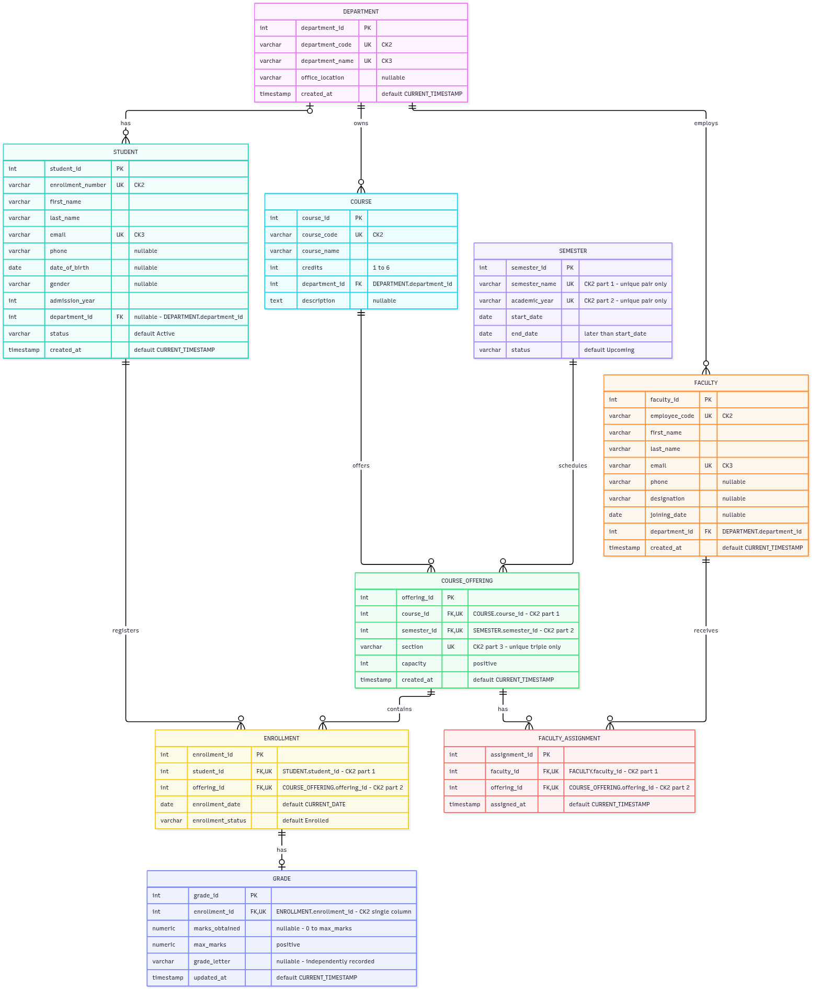
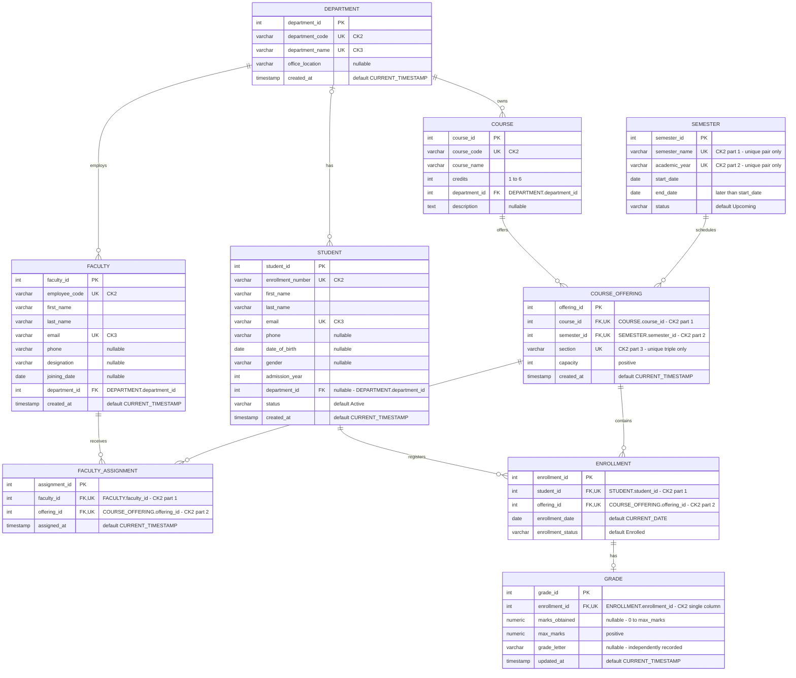

# Corrected ER diagram

[Scalable SVG](ER_Diagram.svg) · [Mermaid source](ER_Diagram.mmd)

## Legend and key annotations

`||` = exactly one, `o|`/`|o` = zero or one, `o{` = zero or many. Read each endpoint as how many instances of that entity can relate to one instance at the other end. Thus `DEPARTMENT |o--o{ STUDENT` means a student has 0..1 department and a department has 0..N students.

PK is the chosen candidate key. UK is an alternate candidate key; **when marked CK2 part n, UK denotes membership in a composite UNIQUE constraint, not individual column uniqueness**. CK numbers are local to each entity. All unmarked-nullability attributes are NOT NULL; only attributes labeled nullable permit NULL. Types are logical: SQLite uses INTEGER IDs, REAL marks and flexible date/time affinities; the original PostgreSQL implementation uses SERIAL, NUMERIC and native date/time types.

| Entity | Alternate candidate keys (PK is also a candidate key) |
| --- | --- |
| Department | department_code; department_name |
| Student | enrollment_number; email |
| Faculty | employee_code; email |
| Course | course_code |
| Semester | (semester_name, academic_year) |
| CourseOffering | (course_id, semester_id, section) |
| FacultyAssignment | (faculty_id, offering_id) |
| Enrollment | (student_id, offering_id) |
| Grade | enrollment_id |

## Corrected participation table

“Children per parent” is the parent's participation in this relationship; “parents per child” is the child's participation. Each row is independent.

| Parent → child | Children per parent | Parents per child | Child-side enforcement |
| --- | --- | --- | --- |
| Department → Student | 0..N (partial) | 0..1 (partial) | nullable department_id FK |
| Department → Faculty | 0..N (partial) | 1 (total) | NOT NULL department_id FK |
| Department → Course | 0..N (partial) | 1 (total) | NOT NULL department_id FK |
| Course → CourseOffering | 0..N (partial) | 1 (total) | NOT NULL course_id FK |
| Semester → CourseOffering | 0..N (partial) | 1 (total) | NOT NULL semester_id FK |
| Faculty → FacultyAssignment | 0..N (partial) | 1 (total) | NOT NULL faculty_id FK |
| CourseOffering → FacultyAssignment | 0..N (partial) | 1 (total) | NOT NULL offering_id FK |
| Student → Enrollment | 0..N (partial) | 1 (total) | NOT NULL student_id FK |
| CourseOffering → Enrollment | 0..N (partial) | 1 (total) | NOT NULL offering_id FK |
| Enrollment → Grade | 0..1 (partial) | 1 (total) | UNIQUE NOT NULL enrollment_id FK |

No FK forces a department, course or semester to have children. A NOT NULL FK requires exactly one parent **for an existing child**; it does not require parents to participate. This corrects the old department/faculty/course and semester minima, and the optional student department endpoint.

Faculty–offering and student–offering are M:N relationships resolved by association entities. Their unique pairs prevent duplicate links; timestamps/status/date belong to the links rather than copied parent facts. A separate offering distinguishes course, semester and section. Grade is dependent through its FK, but has its own surrogate identity; it is not a classical weak entity identified by an owner's key plus partial key.

All ten FKs use ON DELETE RESTRICT and ON UPDATE CASCADE. A nullable student department does not imply ON DELETE SET NULL: a referenced department still cannot be deleted. The same student may enroll in distinct sections/terms because the uniqueness rule is student plus offering. Grade letters are independently recorded, not computed from marks.

## Complete attribute diagram

